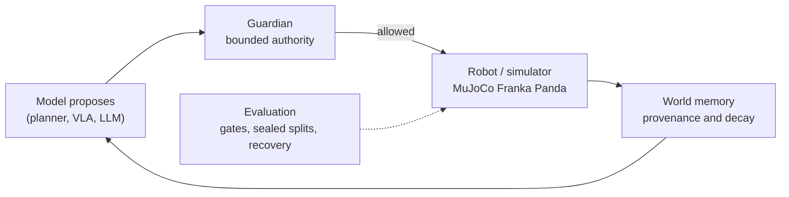

## Vivan Amin

I lead forward deployed engineering for **physical AI**: taking robotics and agentic AI from
research into systems that run with customers. Before that I ran embodied-AI research
incubations, including release go/no-go for a robotics foundation model, and built autonomy,
space and security products across aerospace and defense.

This GitHub is where I build on my own time. The question behind every repo is the same:
**can we prove it works, can it fail safely, and can a team ship it?**

### The thesis

Robots that reason need an operating layer between the model and the motors: something
that bounds what a model may do, measures recovery and not just success, and remembers
what changed in the world. Each project below works on one piece of that layer.

### Projects

| Project | What it shows | Status |
|---|---|---|
| [**physical-ai-learning-lab**](https://github.com/NeuralNomad7/physical-ai-learning-lab) | Research program: can a robot arm learn to push under hidden mass and friction? Pre-registered gates, sealed held-out splits, 284 tests | Phases 1–3 of 7 done · [roadmap](https://github.com/NeuralNomad7/physical-ai-learning-lab/milestones) |
| [**agentic-robotics-lab**](https://github.com/NeuralNomad7/agentic-robotics-lab) | Fail-closed safety gateway, recovery-aware scoring, contradiction-aware memory, lease-based fleet coordination | v0.2.0 · next: [Guardian in the loop](https://github.com/NeuralNomad7/agentic-robotics-lab/milestones) |
| [**satellite-change-detection**](https://github.com/NeuralNomad7/satellite-change-detection) | Siamese U-Net on Sentinel-2: AOI-aware ingestion, cloud-aware inference, ONNX + FastAPI serving | v1.4.0 · benchmark run [planned](https://github.com/NeuralNomad7/satellite-change-detection/issues/28) |
| [**ml-foundations**](https://github.com/NeuralNomad7/ml-foundations) | Tabular ML studies written up with their evaluation caveats | Complete |

### How I run technical work

- **Claim first.** Each project says what it will prove and, just as clearly, what it won't.
- **Gates before code.** Acceptance criteria are written before the build; evidence is saved
  when a gate passes ([example](https://github.com/NeuralNomad7/physical-ai-learning-lab/blob/main/docs/PROGRESS.md)).
- **Decisions on the record.** Trade-offs are logged with their reasons
  ([example](https://github.com/NeuralNomad7/physical-ai-learning-lab/blob/main/docs/DECISIONS.md)).
- **Honest reporting.** Ceilings, caveats and unmeasured results are stated, not hidden. When the
  baseline hit 300/300, that became [a decision to make](https://github.com/NeuralNomad7/physical-ai-learning-lab/issues/1), not a headline.
- **Small, reviewed steps.** Issues → pull requests → CI → tagged releases.

### Toolbox

Python · PyTorch · MuJoCo · scikit-learn · FastAPI · ONNX · GitHub Actions ·
Azure · LLM/VLA evaluation · sim-to-real · edge inference

[LinkedIn](https://www.linkedin.com/in/vivan-amin/)

Personal projects, built on my own time. Views are my own and don't represent my employer.
